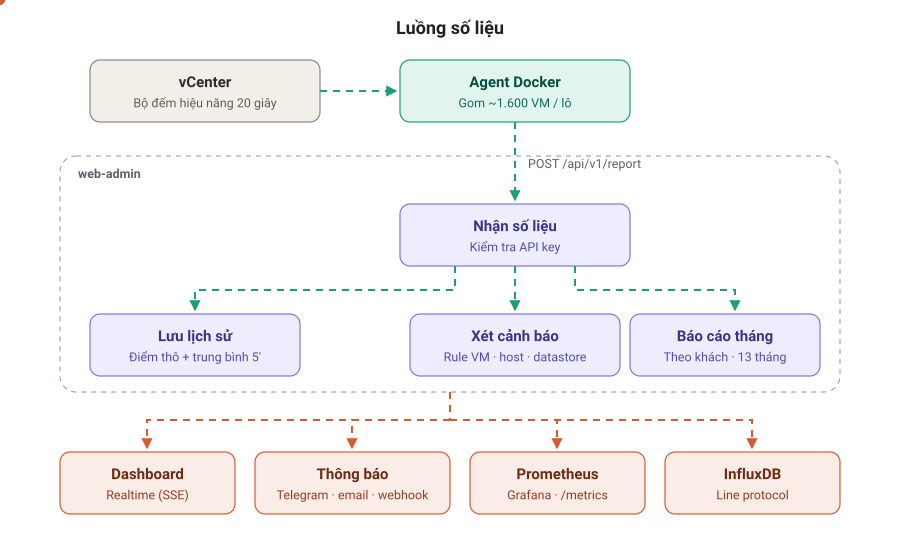

# Monitor vCenter Portal — giám sát VM nhiều site vCenter

Hệ thống giám sát **CPU, RAM, Network, Disk** cho hàng nghìn máy ảo trên **nhiều site VMware vCenter**, gồm:

- **Web admin** cho quản trị và nhân viên: dashboard realtime, biểu đồ chọn khoảng tuỳ ý (kéo chuột để phóng to, chọn từ ngày–đến ngày), host ESXi & datastore, cảnh báo (Telegram / Email / Webhook), báo cáo tháng theo khách hàng, quản lý vCenter / người dùng / API key ngay trên web, 2FA, nhật ký thao tác, sao lưu, Prometheus / InfluxDB.
- **Web khách hàng** (cổng riêng, đặt ra internet): khách xem máy chủ của mình, biểu đồ (phóng to, chọn ngày), cảnh báo, báo cáo tháng.
- **Agent Docker** đặt tại từng site: đọc số liệu từ vCenter của site và gửi về web admin — không cài gì vào VM.

<p align="center"></p>

> Dữ liệu trong repo (IP, site, khách hàng) là **dữ liệu mẫu**. Chế độ demo sinh số liệu giả để chạy thử không cần vCenter.

## Sơ đồ hoạt động

### Luồng số liệu

Mỗi 20 giây agent đọc bộ đếm hiệu năng của vCenter, gom theo lô và gửi về web-admin. Web-admin lưu lịch sử, xét cảnh báo, cộng dồn báo cáo tháng, rồi đẩy ra dashboard realtime, kênh thông báo, Prometheus / Grafana và InfluxDB.

<p align="center"></p>

### Yêu cầu của khách hàng

Cổng khách chỉ chuyển tiếp các API dành cho khách, chỉ cho tài khoản khách đăng nhập, dùng cookie riêng; web-admin lọc dữ liệu theo khách được gán và ẩn thông tin hạ tầng nội bộ.

<p align="center"></p>

> Sơ đồ là file SVG trong `docs/`, sinh bằng `python docs/make_diagrams.py` (tự đổi màu theo giao diện sáng / tối).

## Cấu trúc

| Thư mục | Nội dung | Công nghệ |
|---|---|---|
| [`web-admin/`](web-admin/README.md) | Web quản trị + nhân viên, REST API, nhận số liệu từ agent | Java 21, Spring Boot 3 |
| [`web-khach/`](web-khach/README.md) | Cổng khách hàng, chỉ chuyển tiếp API khách được phép sang web-admin | Java 21, Spring Boot 3 |
| [`agent-docker/`](agent-docker/README.md) | Agent giám sát tại site (collector vCenter) | Python 3.12, pyVmomi, Docker |
| `deploy/` | Cài web-admin + web-khach chạy service (`linux/` systemd, `windows/`), script build jar, Docker Compose demo | systemd, PowerShell |
| [`grafana/`](grafana/stack/README.md) | Prometheus + Grafana dựng sẵn, 5 dashboard (tổng quan, VM, khách hàng, host, datastore) | Docker Compose |
| `tools/` | Tạo chứng chỉ HTTPS tự ký | PowerShell |

## Yêu cầu

- **Server trung tâm** (web-admin + web-khach chạy service): Linux có systemd hoặc Windows Server, **Java 21**.
- **Mỗi site** (agent): **Docker**. Chạy thử demo trên máy cá nhân cũng chỉ cần Docker.
- Thật: vCenter 6.7+ và một tài khoản vCenter **Read-only** (thêm quyền *Guest Operations* nếu muốn đọc `df` trong VM Linux).

## 1. Chạy thử (dữ liệu giả, 2 phút)

```bash
git clone https://github.com/fixnhanh-linux/monitor-vcenter-portal-full.git
cd monitor-vcenter-portal-full/deploy
docker compose -f docker-compose.demo.yml up -d --build
```

1. Mở **http://localhost:3000** → tạo tài khoản **admin** đầu tiên ngay trên trang đăng nhập.
2. Dashboard có 120 VM giả của 6 khách hàng trên 2 site (`SITE-HN`, `SITE-HCM`), host ESXi, datastore, cảnh báo — số liệu đổi mỗi 10 giây.
3. Thử cổng khách: *Cài đặt → Người dùng & bảo mật* → tạo tài khoản vai trò **Khách hàng**, khách `KhachA` → mở **http://localhost:8080** và đăng nhập bằng tài khoản đó.

Dừng: `docker compose -f docker-compose.demo.yml down`. Chạy lại từ đầu: xoá `deploy/demo/data/` và `deploy/demo/config.json` (tạo lại từ `config.example.json`).

## 2. Triển khai thật

### Link tải (bản mới nhất)

| Gói | Dùng cho | Link tải |
|---|---|---|
| `vm-monitor-linux.zip` | Server trung tâm Linux: web-admin + web-khach chạy **service systemd** | [Tải về](https://github.com/fixnhanh-linux/monitor-vcenter-portal-full/releases/latest/download/vm-monitor-linux.zip) |
| `vm-monitor-windows.zip` | Server trung tâm Windows Server: web-admin + web-khach chạy **nền** | [Tải về](https://github.com/fixnhanh-linux/monitor-vcenter-portal-full/releases/latest/download/vm-monitor-windows.zip) |
| `vm-monitor-agent-docker.zip` | **Agent tại mỗi site** (Docker) | [Tải về](https://github.com/fixnhanh-linux/monitor-vcenter-portal-full/releases/latest/download/vm-monitor-agent-docker.zip) |

Tất cả phiên bản: [trang Releases](https://github.com/fixnhanh-linux/monitor-vcenter-portal-full/releases).

### Bước 1 — Web admin + web khách chạy **service** trên server trung tâm (không dùng Docker)

#### Cách A — Linux (systemd): Ubuntu 22.04+ / Debian 12 / RHEL 9

**1. Cài Java 21 và công cụ giải nén**

Ubuntu / Debian:

```bash
sudo apt update
```

```bash
sudo apt install -y openjdk-21-jre-headless unzip wget
```

RHEL / Rocky / Alma:

```bash
sudo dnf install -y java-21-openjdk-headless unzip wget
```

Kiểm tra (phải ra `21` trở lên):

```bash
java -version
```

**2. Tải gói cài đặt**

```bash
cd /tmp
```

```bash
wget https://github.com/fixnhanh-linux/monitor-vcenter-portal-full/releases/latest/download/vm-monitor-linux.zip
```

**3. Giải nén**

```bash
unzip -o vm-monitor-linux.zip
```

```bash
cd vm-monitor-linux
```

**4. Cài service**

```bash
sudo bash install.sh
```

Cổng mặc định 3000 (admin) / 8080 (khách). **Cổng đã bị chương trình khác dùng (vd Grafana chiếm 3000) thì script tự lấy cổng trống kế tiếp** và in ra cổng đã dùng. Muốn tự chọn cổng:

```bash
sudo ADMIN_PORT=3001 KHACH_PORT=8081 bash install.sh
```

Script sẽ: tạo user `vmmonitor`, chép jar vào `/opt/vm-monitor/`, tạo thư mục dữ liệu `/var/lib/vm-monitor/`, tạo file cấu hình `/etc/vm-monitor/admin.env` và `/etc/vm-monitor/khach.env`, cài 2 service `vm-monitor-admin` và `vm-monitor-khach`, bật tự chạy khi khởi động máy và tự chạy lại khi lỗi.

**5. Kiểm tra service đang chạy**

```bash
sudo systemctl status vm-monitor-admin vm-monitor-khach
```

```bash
curl -s -o /dev/null -w "%{http_code}\n" http://localhost:3000/login.html
```

```bash
curl -s http://localhost:8080/healthz
```

Ra `200` và `{"ok":true,"admin":"ok"}` là được (đổi 3000 / 8080 nếu script báo dùng cổng khác).

Web admin không chạy, log báo `Port 3000 was already in use` → chạy lại `sudo ADMIN_PORT=3001 bash install.sh`.

**6. Mở tường lửa (nếu đang bật)**

Ubuntu (ufw):

```bash
sudo ufw allow 3000/tcp
```

```bash
sudo ufw allow 8080/tcp
```

RHEL (firewalld):

```bash
sudo firewall-cmd --permanent --add-port=3000/tcp --add-port=8080/tcp
```

```bash
sudo firewall-cmd --reload
```

**7. Mở web và tạo tài khoản admin**

- Web admin: `http://<ip-server>:3000` → lần đầu vào sẽ có form tạo tài khoản **admin**.
- Web khách: `http://<ip-server>:8080` (chỉ tài khoản vai trò *Khách hàng* đăng nhập được).

**Quản lý hằng ngày**

| Việc | Lệnh |
|---|---|
| Khởi động lại | `sudo systemctl restart vm-monitor-admin vm-monitor-khach` |
| Dừng | `sudo systemctl stop vm-monitor-khach vm-monitor-admin` |
| Xem log service | `sudo journalctl -u vm-monitor-admin -f` |
| Xem log ứng dụng | `sudo tail -f /var/lib/vm-monitor/data/portal.log` |
| Đổi tên / cổng web khách | sửa `/etc/vm-monitor/khach.env` rồi `sudo systemctl restart vm-monitor-khach` |
| Cập nhật bản mới | `sudo /opt/vm-monitor/update.sh` (xem mục dưới) |
| Gỡ cài đặt | `sudo bash uninstall.sh` (giữ dữ liệu trong `/var/lib/vm-monitor`) |

#### Cập nhật bản mới khi đang chạy

Dữ liệu (`/var/lib/vm-monitor`: tài khoản, vCenter, lịch sử, báo cáo) và cấu hình (`/etc/vm-monitor`: cổng, tên cổng khách) **không bị đụng tới** — chỉ thay 2 file jar. Gián đoạn khoảng 20–30 giây.

Cập nhật lên bản mới nhất:

```bash
sudo /opt/vm-monitor/update.sh
```

Script: tải bản mới nhất ở Releases → so với bản đang chạy (giống thì bỏ qua) → giữ bản cũ ở `/opt/vm-monitor/prev/` và sao lưu `config.json` vào `backups/` → thay jar, khởi động lại → **bản mới không chạy được thì tự quay lại bản cũ**.

Cập nhật lên một phiên bản cụ thể:

```bash
sudo /opt/vm-monitor/update.sh v1.0.1
```

Quay lại bản trước:

```bash
sudo /opt/vm-monitor/update.sh --rollback
```

Xem đang chạy bản nào:

```bash
cat /opt/vm-monitor/VERSION
```

Server cài bằng bản cũ chưa có `update.sh` (v1.0.0): chạy một lần lệnh dưới, các lần sau dùng `sudo /opt/vm-monitor/update.sh`:

```bash
curl -fsSL https://raw.githubusercontent.com/fixnhanh-linux/monitor-vcenter-portal-full/main/deploy/linux/update.sh | sudo bash
```

Tự build từ git thay vì tải Releases:

```bash
cd monitor-vcenter-portal-full && git pull
```

```bash
bash deploy/build.sh && sudo bash deploy/linux/install.sh deploy/dist
```

#### Cách B — Windows Server

**1.** Cài Java 21: tải bản *JRE 21 — Windows x64 .msi* ở [adoptium.net](https://adoptium.net/temurin/releases/?version=21), khi cài chọn **Set JAVA_HOME** và **Add to PATH**.

**2.** Tải [`vm-monitor-windows.zip`](https://github.com/fixnhanh-linux/monitor-vcenter-portal-full/releases/latest/download/vm-monitor-windows.zip), chuột phải → *Extract All…* (ví dụ ra `C:\Setup\vm-monitor-windows`).

**3.** Mở **PowerShell bằng quyền Administrator**, chạy:

```powershell
cd C:\Setup\vm-monitor-windows
```

```powershell
powershell -ExecutionPolicy Bypass -File .\install.ps1
```

Script tạo 2 tác vụ nền chạy bằng SYSTEM lúc khởi động máy (`VM Monitor - Web admin`, `VM Monitor - Web khach`), tự chạy lại khi lỗi, mở tường lửa cổng 3000 / 8080. Dữ liệu ở `C:\VMMonitor`, cấu hình web khách ở `C:\VMMonitor\khach.env`.

**4.** Mở `http://localhost:3000` → tạo tài khoản admin. Gỡ: `powershell -ExecutionPolicy Bypass -File .\uninstall.ps1`.

#### Sau khi cài (cả hai cách)

- Để cổng **3000 chỉ trong mạng nội bộ / VPN** — agent các site gọi vào cổng này.
- Web khách (8080) đặt sau reverse proxy có HTTPS (nginx / Caddy) rồi mới mở ra internet, đặt `TRUST_PROXY=1` trong `khach.env`.
- HTTPS cho web admin: `tools/make_cert.ps1` hoặc chứng chỉ thật → *Cài đặt → Người dùng & bảo mật → Bảo mật*.
- Tự build thay vì tải: `bash deploy/build.sh` (ra 2 file jar ở `deploy/dist/`), rồi chạy `sudo bash deploy/linux/install.sh deploy/dist`.

> Muốn chạy web-admin + web-khach bằng Docker thay vì service (tuỳ chọn): `cd deploy && mkdir portal-data && docker compose up -d --build`.

### Bước 2 — Agent tại mỗi site (Docker)

**1. Tạo API key cho agent** — Web admin → *Cài đặt → vCenter → ＋ Thêm collector cho site ở xa* → đặt tên (vd `site-hn`) → copy **API key** (chỉ hiện một lần).

**2. Chuẩn bị máy ở site** — một máy Linux có Docker, thấy được vCenter của site và gọi ra được web admin (cổng 3000). Chưa có Docker:

```bash
curl -fsSL https://get.docker.com | sudo sh
```

**3. Tải và giải nén agent**

```bash
cd /opt
```

```bash
sudo wget https://github.com/fixnhanh-linux/monitor-vcenter-portal-full/releases/latest/download/vm-monitor-agent-docker.zip
```

```bash
sudo unzip -o vm-monitor-agent-docker.zip
```

```bash
cd vm-monitor-agent
```

**4. Khai báo địa chỉ web admin và API key**

```bash
sudo cp .env.example .env
```

```bash
sudo nano .env
```

Sửa 2 dòng (giữ nguyên các dòng khác):

```
MONITOR_SERVER=http://<ip-web-admin>:3000
MONITOR_TOKEN=<API key vừa copy>
```

Web admin dùng HTTPS chứng chỉ tự ký thì đặt thêm `MONITOR_INSECURE=1`.

**5. Chạy agent**

```bash
sudo docker compose up -d --build
```

**6. Xem log**

```bash
sudo docker compose logs -f
```

Thấy dòng *"Portal nhận diện collector này là 'site-hn'"* là đã kết nối. Bấm `Ctrl+C` để thoát xem log (agent vẫn chạy).

**7. Gán vCenter cho agent** — Web admin → *Cài đặt → vCenter → Thêm vCenter*: địa chỉ, tài khoản (Read-only), mật khẩu, **Chạy bởi collector** = `site-hn` → Lưu. Agent nhận cấu hình trong ~30 giây, số liệu VM hiện trên dashboard sau 1–2 phút.

Máy site không có internet: ở máy có internet chạy `agent-docker/build-image.ps1` (ra `vm-monitor-agent.tar`), chép sang rồi `sudo docker load -i vm-monitor-agent.tar` trước bước 5.

Quản lý agent: `sudo docker compose restart` · `sudo docker compose down` · nâng cấp: tải zip mới, giải nén đè, `sudo docker compose up -d --build`.

#### Hoặc: chạy collector không dùng Docker

```bash
cd agent-docker/collector
pip install -r ../requirements.txt
MONITOR_SERVER=http://<ip-web-admin>:3000 MONITOR_TOKEN=<API key collector> python vcenter_collector.py
```

- Windows PowerShell: `$env:MONITOR_SERVER="http://<ip-web-admin>:3000"; $env:MONITOR_TOKEN="<API key>"; python vcenter_collector.py`.
- Có thể ghi vào `config.json` cạnh collector thay cho biến môi trường: `{"collector": {"portal": "http://<ip-web-admin>:3000", "token": "<API key>"}}`.
- Chạy nền: Windows dùng Task Scheduler, Linux dùng systemd.

### Bước 3 — Cấu hình trên web (Cài đặt)

| Tab | Việc cần làm |
|---|---|
| Khách hàng | chọn cách nhận diện khách của VM: gán tay, quy tắc tên, vSphere Tag, Custom Attribute, thư mục, regex tên / Notes; gợi ý gán tự động |
| Rule cảnh báo | ngưỡng CPU / RAM / Disk / Network / mất kết nối cho VM, host, datastore |
| Kênh gửi | Telegram (bot token + chat id), Email (SMTP), Webhook (Slack / Discord / Teams / JSON) |
| Người dùng & bảo mật | tài khoản Quản trị / Nhân viên (giới hạn site) / Nhân viên phụ trách khách / Khách hàng, bắt buộc 2FA, HTTPS, API key |
| Vận hành | tự dọn VM biến mất, sao lưu hằng ngày, gửi email báo cáo tháng |
| InfluxDB | ghi số liệu sang InfluxDB (định dạng riêng hoặc giống Telegraf vSphere) |

### Bước 4 (tuỳ chọn) — Grafana

*Cài đặt → Người dùng & bảo mật* → tạo API key vai trò **read** → làm theo [grafana/stack/README.md](grafana/stack/README.md) (`docker compose up -d` trong `grafana/stack`).

## Vai trò người dùng

| Vai trò | Thấy gì | Đăng nhập ở |
|---|---|---|
| Quản trị | mọi thứ, kể cả Cài đặt | web admin |
| Nhân viên | dashboard, host, datastore, báo cáo, Grafana; có thể giới hạn theo site | web admin (trang *Việc của tôi*) |
| Nhân viên phụ trách khách | VM + báo cáo của các khách được giao | web admin |
| Khách hàng | máy chủ của mình, không thấy tên site / cluster / host nội bộ | web khách |

## API

REST API v1 (JSON, API key qua header `X-API-Key`): danh sách / chi tiết / chuỗi số liệu VM, host, datastore, cảnh báo, báo cáo tháng, CSV, realtime (SSE). Tài liệu đầy đủ: `http://<web-admin>/docs`. Prometheus: `GET /metrics`.

## Build từng phần (không dùng Compose)

```bash
docker build -t vm-monitor-admin web-admin
docker build -t vm-monitor-khach web-khach
docker build -t vm-monitor-agent agent-docker
```

## Sao lưu & khôi phục

Toàn bộ trạng thái nằm trong `/var/lib/vm-monitor/` (Windows: `C:VMMonitor`, Docker: `deploy/portal-data/`) (`config.json` + `data/`). Web admin tự sao lưu hằng ngày vào `backups/` trong thư mục đó (bật / chỉnh ở *Cài đặt → Vận hành*). Bản sao lưu chứa khoá giải mã mật khẩu vCenter — cất giữ cẩn thận.
