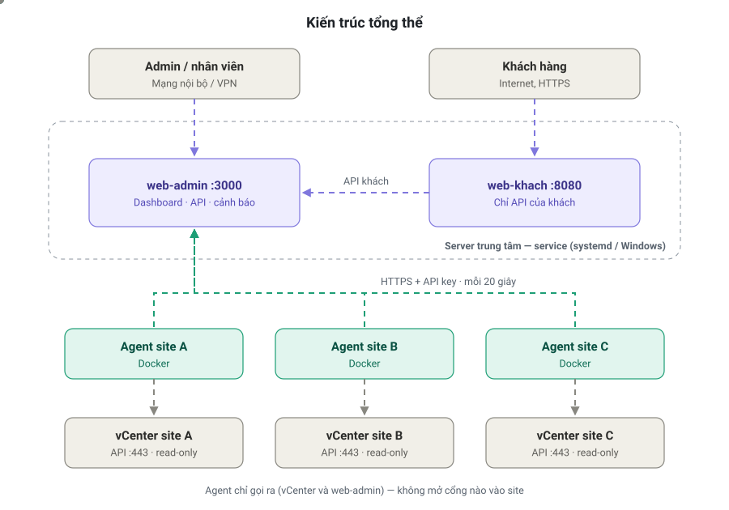
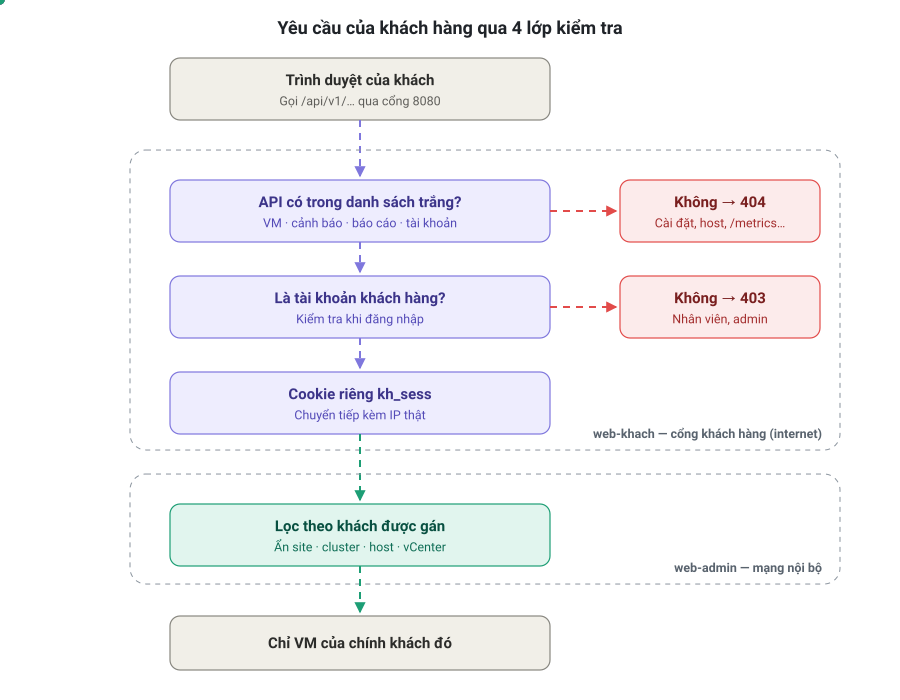

# Monitor vCenter Portal — giám sát VM nhiều site vCenter

Hệ thống giám sát **CPU, RAM, Network, Disk** cho hàng nghìn máy ảo trên **nhiều site VMware vCenter**, gồm:

- **Web admin** cho quản trị và nhân viên: dashboard realtime, host ESXi & datastore, cảnh báo (Telegram / Email / Webhook), báo cáo tháng theo khách hàng, quản lý vCenter / người dùng / API key ngay trên web, 2FA, nhật ký thao tác, sao lưu, Prometheus / InfluxDB.
- **Web khách hàng** (cổng riêng, đặt ra internet): khách xem máy chủ của mình, biểu đồ, cảnh báo, báo cáo tháng.
- **Agent Docker** đặt tại từng site: đọc số liệu từ vCenter của site và gửi về web admin — không cài gì vào VM.

<p align="center"></p>

> Dữ liệu trong repo (IP, site, khách hàng) là **dữ liệu mẫu**. Chế độ demo sinh số liệu giả để chạy thử không cần vCenter.

## Sơ đồ hoạt động

### Luồng số liệu

Mỗi 20 giây agent đọc bộ đếm hiệu năng của vCenter, gom theo lô và gửi về web-admin. Web-admin lưu lịch sử, xét cảnh báo, cộng dồn báo cáo tháng, rồi đẩy ra dashboard realtime, kênh thông báo, Prometheus / Grafana và InfluxDB.

<p align="center"></p>

### Yêu cầu của khách hàng

Cổng khách chỉ chuyển tiếp các API dành cho khách, chỉ cho tài khoản khách đăng nhập, dùng cookie riêng; web-admin lọc dữ liệu theo khách được gán và ẩn thông tin hạ tầng nội bộ.

<p align="center"></p>

> Sơ đồ là file SVG trong `docs/`, sinh bằng `python docs/make_diagrams.py` (tự đổi màu theo giao diện sáng / tối).

## Cấu trúc

| Thư mục | Nội dung | Công nghệ |
|---|---|---|
| [`web-admin/`](web-admin/README.md) | Web quản trị + nhân viên, REST API, nhận số liệu từ agent | Java 21, Spring Boot 3 |
| [`web-khach/`](web-khach/README.md) | Cổng khách hàng, chỉ chuyển tiếp API khách được phép sang web-admin | Java 21, Spring Boot 3 |
| [`agent-docker/`](agent-docker/README.md) | Agent giám sát tại site (collector vCenter) | Python 3.12, pyVmomi, Docker |
| `deploy/` | Docker Compose chạy web-admin + web-khach (thật và demo) | Docker Compose |
| [`grafana/`](grafana/stack/README.md) | Prometheus + Grafana dựng sẵn, 5 dashboard (tổng quan, VM, khách hàng, host, datastore) | Docker Compose |
| `tools/` | Tạo chứng chỉ HTTPS tự ký | PowerShell |

## Yêu cầu

- **Docker** (Docker Desktop trên Windows / macOS, Docker Engine trên Linux) — không cần cài Java, Maven hay Python: mọi thứ build trong Docker.
- Thật: vCenter 6.7+ và một tài khoản vCenter **Read-only** (thêm quyền *Guest Operations* nếu muốn đọc `df` trong VM Linux).

## 1. Chạy thử (dữ liệu giả, 2 phút)

```bash
git clone https://github.com/fixnhanh-linux/monitor-vcenter-portal-full.git
cd monitor-vcenter-portal-full/deploy
docker compose -f docker-compose.demo.yml up -d --build
```

1. Mở **http://localhost:3000** → tạo tài khoản **admin** đầu tiên ngay trên trang đăng nhập.
2. Dashboard có 120 VM giả của 6 khách hàng trên 2 site (`SITE-HN`, `SITE-HCM`), host ESXi, datastore, cảnh báo — số liệu đổi mỗi 10 giây.
3. Thử cổng khách: *Cài đặt → Người dùng & bảo mật* → tạo tài khoản vai trò **Khách hàng**, khách `KhachA` → mở **http://localhost:8080** và đăng nhập bằng tài khoản đó.

Dừng: `docker compose -f docker-compose.demo.yml down`. Chạy lại từ đầu: xoá `deploy/demo/data/` và `deploy/demo/config.json` (tạo lại từ `config.example.json`).

## 2. Triển khai thật

### Bước 1 — Web admin + web khách trên một server

```bash
cd deploy
mkdir portal-data                 # cấu hình + dữ liệu sẽ nằm ở đây (sao lưu thư mục này)
docker compose up -d --build
```

- Web admin: `http://<server>:3000` → tạo tài khoản admin. Nên để cổng 3000 **chỉ trong mạng nội bộ / VPN** (agent các site gọi vào cổng này).
- Web khách: `http://<server>:8080` — đặt sau reverse proxy có HTTPS (nginx / Caddy) rồi mới mở ra internet, đặt `TRUST_PROXY: "1"`.
- Đổi tên cổng khách: biến `BRAND_NAME` trong `deploy/docker-compose.yml`.
- HTTPS cho web admin: `tools/make_cert.ps1` hoặc chứng chỉ thật → *Cài đặt → Người dùng & bảo mật → Bảo mật*.

### Bước 2 — Agent tại mỗi site

1. Web admin → *Cài đặt → vCenter → ＋ Thêm collector cho site ở xa* → đặt tên (vd `site-hn`) → copy **API key**.
2. Trên một máy có Docker trong mạng của site (thấy được vCenter, gọi ra được web admin):
   ```bash
   cd agent-docker
   cp .env.example .env        # MONITOR_SERVER=http://<web-admin>:3000, MONITOR_TOKEN=<API key>
   docker compose up -d --build
   docker compose logs -f       # thấy "Portal nhận diện collector này là 'site-hn'" là xong
   ```
   Máy không có internet: chạy `agent-docker/build-image.ps1` ở máy khác, mang `vm-monitor-agent.tar` sang rồi `docker load -i vm-monitor-agent.tar`.
3. Web admin → *Cài đặt → vCenter → Thêm vCenter*: địa chỉ, tài khoản, mật khẩu, **Chạy bởi collector** = `site-hn` → Lưu. Agent áp dụng trong ~30 giây; trạng thái hiện ngay trên trang.

#### Hoặc: chạy collector ngoài Docker (cùng máy với web-admin, hoặc máy Windows / Linux sẵn có)

Không muốn dùng Docker ở site? Chạy thẳng collector Python, gửi vào web-admin bằng API key — cách đang dùng khi web-admin + web-khach chạy Docker còn collector chạy trên Windows:

```bash
cd agent-docker/collector
pip install -r ../requirements.txt
# Windows PowerShell:  $env:MONITOR_SERVER="http://localhost:3000"; $env:MONITOR_TOKEN="<API key collector>"
MONITOR_SERVER=http://localhost:3000 MONITOR_TOKEN=<API key collector> python vcenter_collector.py
```

- API key vai trò **collector** tạo như Bước 2.1; tên collector = tên key. Trong *Cài đặt → vCenter* chọn **Chạy bởi collector** = tên key cho các vCenter collector này phụ trách.
- Collector cùng máy với web-admin chạy trong Docker vẫn **cần API key**: container không coi kết nối từ máy chủ là "cùng máy".
- Có thể ghi key vào file `config.json` cạnh collector thay cho biến môi trường: `{"collector": {"portal": "http://localhost:3000", "token": "<API key>"}}`.
- Chạy nền: Windows dùng Task Scheduler (khởi động khi đăng nhập + lặp lại 5 phút), Linux dùng systemd.

### Bước 3 — Cấu hình trên web (Cài đặt)

| Tab | Việc cần làm |
|---|---|
| Khách hàng | chọn cách nhận diện khách của VM: gán tay, quy tắc tên, vSphere Tag, Custom Attribute, thư mục, regex tên / Notes; gợi ý gán tự động |
| Rule cảnh báo | ngưỡng CPU / RAM / Disk / Network / mất kết nối cho VM, host, datastore |
| Kênh gửi | Telegram (bot token + chat id), Email (SMTP), Webhook (Slack / Discord / Teams / JSON) |
| Người dùng & bảo mật | tài khoản Quản trị / Nhân viên (giới hạn site) / Nhân viên phụ trách khách / Khách hàng, bắt buộc 2FA, HTTPS, API key |
| Vận hành | tự dọn VM biến mất, sao lưu hằng ngày, gửi email báo cáo tháng |
| InfluxDB | ghi số liệu sang InfluxDB (định dạng riêng hoặc giống Telegraf vSphere) |

### Bước 4 (tuỳ chọn) — Grafana

*Cài đặt → Người dùng & bảo mật* → tạo API key vai trò **read** → làm theo [grafana/stack/README.md](grafana/stack/README.md) (`docker compose up -d` trong `grafana/stack`).

## Vai trò người dùng

| Vai trò | Thấy gì | Đăng nhập ở |
|---|---|---|
| Quản trị | mọi thứ, kể cả Cài đặt | web admin |
| Nhân viên | dashboard, host, datastore, báo cáo, Grafana; có thể giới hạn theo site | web admin (trang *Việc của tôi*) |
| Nhân viên phụ trách khách | VM + báo cáo của các khách được giao | web admin |
| Khách hàng | máy chủ của mình, không thấy tên site / cluster / host nội bộ | web khách |

## API

REST API v1 (JSON, API key qua header `X-API-Key`): danh sách / chi tiết / chuỗi số liệu VM, host, datastore, cảnh báo, báo cáo tháng, CSV, realtime (SSE). Tài liệu đầy đủ: `http://<web-admin>/docs`. Prometheus: `GET /metrics`.

## Build từng phần (không dùng Compose)

```bash
docker build -t vm-monitor-admin web-admin
docker build -t vm-monitor-khach web-khach
docker build -t vm-monitor-agent agent-docker
```

## Sao lưu & khôi phục

Toàn bộ trạng thái nằm trong `deploy/portal-data/` (`config.json` + `data/`). Web admin tự sao lưu hằng ngày vào `portal-data/backups/` (bật / chỉnh ở *Cài đặt → Vận hành*). Bản sao lưu chứa khoá giải mã mật khẩu vCenter — cất giữ cẩn thận.
